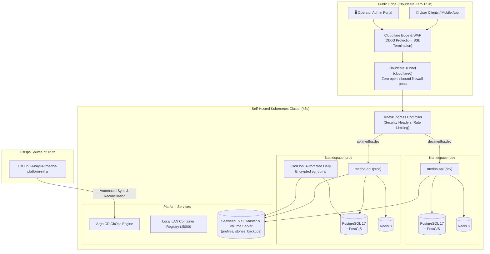

<div align="center">

# ⚙️ Medha Platform Infrastructure
### Production Self-Hosted Kubernetes (k3s) · Argo CD GitOps · Zero-Trust Ingress · Multi-Tier Storage Topology

[](https://k3s.io/)
[](https://argoproj.github.io/cd/)
[](https://www.terraform.io/)
[](https://www.cloudflare.com/)
[](https://github.com/seaweedfs/seaweedfs)
[](https://traefik.io/)
[](LICENSE)

**The declarative GitOps and Infrastructure-as-Code (IaC) repository powering the Medha Platform across production and development environments.**

[Architecture](#-infrastructure-architecture) • [GitOps Pipeline](#-declarative-gitops-workflow) • [Network & Security](#-network-topology--security-perimeter) • [Storage Architecture](#-storage-topology-seaweedfs) • [Contributors](#-contributors)

---

</div>

## 📌 Overview

**Medha Platform Infrastructure** manages the full declarative lifecycle of the self-hosted Kubernetes cluster, edge networking, secrets encryption, object storage, and automated GitOps continuous delivery for the [Medha Platform API](https://github.com/vi-nayKR/medha-platform-api).

```
┌─────────────────────────────────────────────────────────────────────────────────┐
│                              INFRASTRUCTURE METRICS                             │
├───────────────────────┬─────────────────────────┬───────────────────────────────┤
│  🚀 Argo CD GitOps    │  🛡️ Cloudflare Tunnels  │  🗄️ SeaweedFS S3 Engine       │
│  🔒 SealedSecrets     │  🌐 Isolated Dev / Prod │  ⚡ Zero Port-Forwarding      │
└───────────────────────┴─────────────────────────┴───────────────────────────────┘
```

---

## 🏛️ Infrastructure Architecture



---

## 🚀 Declarative GitOps Workflow (Argo CD + Kustomize)

All deployments are managed purely through GitOps pull reconciliation:

```
[ Developer Git Push ] ──► [ GitHub Actions CI ] ──► [ Build & Push Image (:5000) ]
                                                            │
                                                            ▼
                                           [ Update newTag in Kustomize ]
                                                            │
                                                            ▼
[ Live k8s Cluster ] ◄── [ Argo CD Auto-Sync ] ◄── [ Commit to medha-platform-infra ]
```

1. **Environment Isolation:** Dev (`kubernetes/overlays/dev`) and Production (`kubernetes/overlays/prod`) utilize distinct namespaces, SealedSecrets encryption keys, and isolated resource quotas.
2. **Deterministic Kustomize Overlays:** Image tags are pinned to exact immutable Git commit SHAs (`newTag: 327afe2`), preventing configuration drift.
3. **Automated Rollbacks:** If readiness probes fail during canary rollout, Argo CD automatically pauses deployment and rolls back to the previous healthy replica set.

---

## 🛡️ Network Topology & Security Perimeter

- **Zero Inbound Open Ports:** The entire cluster communicates with the outside world strictly via outbound **Cloudflare Tunnels (`cloudflared`)**. No public IPv4/IPv6 ports are opened on local firewalls.
- **Default-Deny NetworkPolicies:** Inter-pod communication is gated by Kubernetes `NetworkPolicy` rules. Pods in the `dev` namespace cannot address services in `prod`.
- **SealedSecrets Encryption:** Sensitive credentials (database passwords, JWT signing keys, SMS provider tokens) are encrypted client-side using `kubeseal` and safe to store declaratively in Git.

---

## 🗄️ Storage Topology (SeaweedFS)

The platform utilizes **SeaweedFS** as an ultra-fast, S3-compatible blob and object storage engine:
- **Low Latency:** O(1) disk lookups bypass heavy file metadata operations.
- **Multi-Domain Bucket Separation:** Dedicated isolated storage buckets for user profiles (`/profiles`), ephemeral stories (`/stories`), and automated database dumps (`/backups`).
- **Presigned Upload URLs:** Mobile clients upload media directly to storage nodes using short-lived S3 presigned PUT URLs, eliminating backend API memory bottlenecks.

---

## 📁 Repository Structure

```
.
├── argocd/                   # Argo CD Application manifests & root kustomization
├── docker/                   # Two-node split deployment scripts, supervisor, nftables
│   ├── firewall/             # nftables network isolation rules
│   ├── nginx/                # Reverse proxy configs for staging/production
│   └── supervisor/           # Process supervision configs (PostgreSQL, SeaweedFS)
├── docs/                     # Architectural guides, runbooks & migration SOPs
├── kubernetes/               # Declarative k8s manifests
│   ├── apps/                 # Application deployments (API, Admin, Web)
│   ├── base/                 # Reusable base manifests (Postgres, Redis, SeaweedFS)
│   └── overlays/             # Environment-specific overlays (dev, prod)
├── platform/                 # Cluster platform tooling (cloudflared, local registry, traefik)
└── terraform/                # Infrastructure as Code
    └── cloudflare/           # Cloudflare DNS, WAF rulesets, and Access policies
```

---

## 👥 Contributors

- **Vinay K R** ([@vi-nayKR](https://github.com/vi-nayKR)) — Co-Architect & Infrastructure Engineer
- **Koushik H R** ([@koushik-hr](https://github.com/koushikhr)) — Lead Infrastructure & DevOps Engineer

---

## 📄 License

This project is licensed under the MIT License — see the [LICENSE](LICENSE) file for details.
