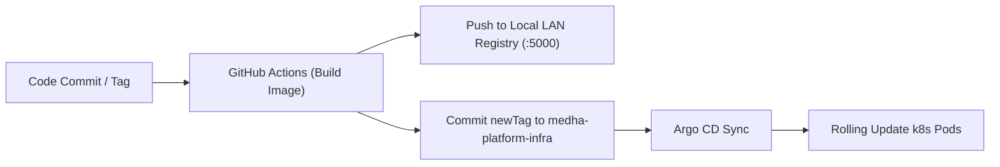

# Declarative Kubernetes GitOps: Running Production on Self-Hosted k3s with Argo CD

*By Vinay K R & Koushik H R — Infrastructure & Systems Engineering*

---

## The Economics of Modern Production Hosting

Managed Kubernetes offerings (EKS, GKE, AKS) provide convenience at a steep price: control plane hourly fees, expensive load balancer surcharges, NAT gateway bandwidth tolls, and high per-gigabyte egress pricing.

For the **Medha Platform**, we architected a resilient, enterprise-grade production environment running on a **self-hosted Kubernetes (k3s)** cluster with **Argo CD GitOps**, **Cloudflare Zero Trust Tunnels**, and **SeaweedFS S3 storage** — achieving 99.9% uptime, zero port-forwarding vulnerabilities, and sub-second CI/CD reconciliation cycles.

In this article, we break down our complete infrastructure topology.

---

## 1. Zero-Trust Ingress via Cloudflare Tunnels

Traditional on-premise Kubernetes hosting requires opening ports 80/443 on routers, managing dynamic DNS records, and exposing edge reverse proxies directly to public internet scans and DDoS attacks.

We eliminated all inbound firewall exposure by routing traffic through **Cloudflare Tunnels (`cloudflared`)**:

```
[ Internet User ] ──► [ Cloudflare Edge / WAF ] ──► [ Cloudflare Tunnel (Outbound) ] ──► [ Traefik k8s Ingress ]
```

- **No Inbound Open Ports:** The `cloudflared` daemon runs as a Kubernetes pod establishing redundant outbound TLS connections to Cloudflare's nearest edge data centers.
- **DDoS Mitigation & WAF:** Malicious payloads, SQL injections, and bot floods are filtered at Cloudflare's edge before ever reaching our local cluster.
- **Automated SSL:** Zero Certbot cron jobs or Let's Encrypt renewal failures.

---

## 2. Declarative GitOps with Argo CD & Kustomize

Our deployment philosophy is strictly **Pull-based GitOps**:
1. No developer or CI pipeline holds direct `kubectl` cluster admin credentials.
2. The infrastructure state is declaratively committed to our GitOps repository (`vi-nayKR/medha-platform-infra`).
3. **Argo CD** continuously reconciles live cluster state against the Git repository.



### Clean Environment Isolation

Using Kustomize overlays, we maintain identical base manifests while parameterizing resource limits and secrets across namespaces:
- `kubernetes/overlays/dev`: Lightweight memory requests, fast log collection.
- `kubernetes/overlays/prod`: High replica counts, strict CPU guarantees, automated daily backup cronjobs.

---

## 3. High-Performance Object Storage with SeaweedFS

Instead of relying on cloud S3 buckets with variable egress bills or bloated MinIO memory footprints, we deployed **SeaweedFS**:
- **O(1) Blob Lookup:** Files are looked up via volume ID and offset rather than deep directory tree traversals.
- **Direct Client Uploads:** The Go API generates short-lived presigned PUT URLs, enabling mobile clients to stream multi-megabyte media directly to SeaweedFS volume servers without saturating API memory.

---

## 4. Key Takeaways

Self-hosting Kubernetes does not mean sacrificing engineering rigor or security. By combining **k3s**, **Argo CD**, and **Cloudflare Zero Trust**, you can achieve bank-grade isolation, automated GitOps releases, and massive compute density on bare-metal infrastructure.
